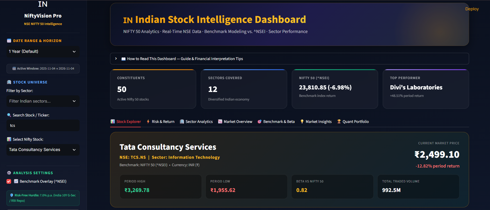
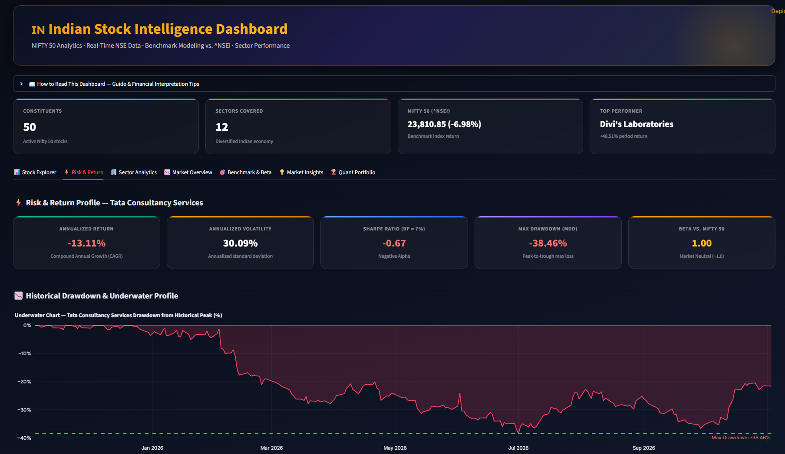
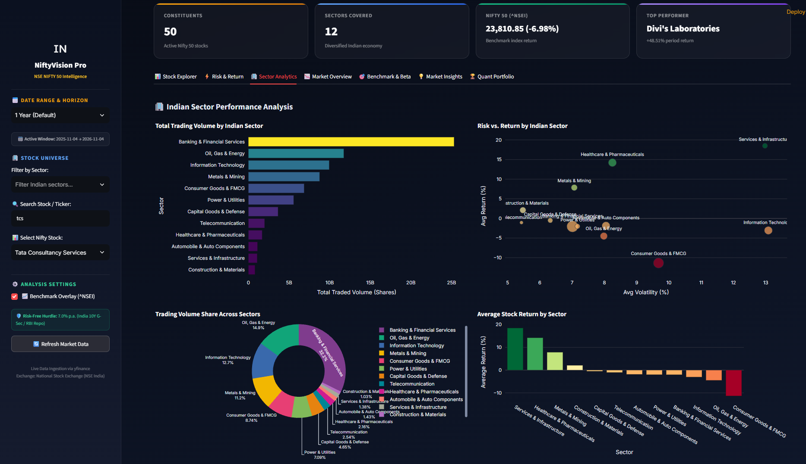
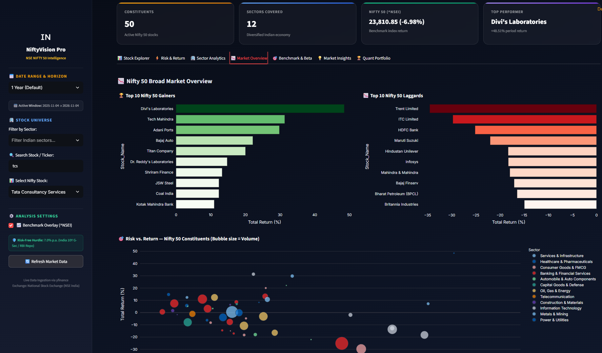

# 🇮🇳 Indian Stock Intelligence Dashboard (NSE & NIFTY 50)

<div align="center">

### Interactive Quantitative Financial Intelligence Platform Built with Python, Streamlit & Plotly
*Real-time NSE market analytics, Base-100 benchmark modeling vs. NIFTY 50 (`^NSEI`), CAPM risk-return metrics, and portfolio diversification heatmaps.*

[](https://www.python.org/)
[](https://streamlit.io/)
[](https://plotly.com/)
[](https://pandas.pydata.org/)
[](https://pypi.org/project/yfinance/)
[-orange?style=for-the-badge)](https://www.nseindia.com/)

</div>

---

## 📌 Project Overview

The **Indian Stock Intelligence Dashboard** is an enterprise-grade quantitative equity intelligence platform designed for investors, portfolio managers, and equity research analysts tracking the **National Stock Exchange of India (NSE)**.

Focused on the **NIFTY 50 Index (`^NSEI`)** and its constituents, the dashboard transforms raw historical tick and price data into actionable risk-adjusted insights. It enables users to evaluate stock momentum, benchmark excess alpha, compute downside tail-risk metrics (drawdowns), and model multi-asset portfolio diversification.

All data is fetched dynamically via `yfinance` using `.NS` tickers, accelerated by caching (`@st.cache_data`), with mathematical calculations encapsulated inside an independently unit-tested finance engine (`finance_metrics.py`).

---

## 🚀 Key Features

### 1. 📈 Base 100 Benchmark Comparison Chart
* **Growth of ₹100 Invested:** Normalizes both the selected stock and the Nifty 50 index (`^NSEI`) to **100** on the start date:
  $$\text{Index}_t = \left(\frac{P_t}{P_0}\right) \times 100$$
* Instantly visualizes whether an equity generated **positive alpha** over the benchmark or lagged the broader market.
* Displays a net alpha badge (points gained or lost relative to Nifty 50).

### 2. ⚡ Quantitative Risk & Return Profiling
Calculates and displays core institutional metrics:
* **Annualized Return (CAGR):** Compounded annual growth normalized over 252 trading sessions.
* **Annualized Volatility ($\sigma_{\text{ann}}$):** Annualized standard deviation of daily returns.
* **Sharpe Ratio (7.0% Hurdle):** Measures excess return per unit of volatility relative to India's **7.0% risk-free rate** (matching the 10-Year Government of India Bond yield / RBI policy rate).
* **Maximum Drawdown (MDD) & Underwater Chart:** Visualizes peak-to-trough drop percentages over time with an automated threshold alert line.
* **CAPM Beta ($\beta$) vs. Nifty 50:** Quantifies systemic risk sensitivity and cyclicality ($\beta > 1.0$: Aggressive; $\beta < 1.0$: Defensive).

### 3. 🔗 Custom Multi-Stock Return Correlation Heatmap
* An interactive multi-select tool enabling users to pick 2 to 15 stocks across sectors.
* Generates a dynamic Pearson correlation matrix of daily returns.
* **Automated Diversification Insights:** Automatically detects and highlights:
  * **Strongest Co-Movement Pair:** Highest positive correlation ($r \to +1.0$).
  * **Best Diversification Pair:** Lowest or negative correlation ($r \le 0.0$), ideal for risk hedging.

### 4. 🏢 Indian Sector Analytics
* Sector-level performance tracking across **11 major Indian economic sectors** (Banking & Financials, IT, Energy, Auto, FMCG, Pharma, Metals, etc.).
* Comparative risk vs. return scatter plots, trading volume share donuts, and summary ranking tables.

### 5. 🎯 Capital Asset Pricing Model (CAPM) Characteristic Line
* Scatter plot of Stock Daily Returns (%) vs. Nifty 50 Daily Returns (%) with an OLS regression trendline ($y = \beta x + \alpha$).
* Calculates Annualized Alpha ($\alpha$) and Coefficient of Determination ($R^2$).

### 6. 📅 Date Range Selector & Clean Sidebar Layout
* Flexible timeframe presets: `1 Month`, `3 Months`, `6 Months`, `1 Year (Default)`, `2 Years`, `YTD`, and `Custom Date Range`.
* Real-time search by company name or NSE ticker.
* Built-in **"How to Read This Dashboard"** collapsible user guide for non-quant readers.

---

## 📸 Screenshots & Visual Preview

| View | Screenshot |
| :--- | :--- |
| **Stock Explorer & Base 100 Chart** | <br>*Normalized growth of ₹100 vs. Nifty 50 with candlestick & volume analysis.* |
| **Risk & Return Profile** | <br>*Sharpe ratio, annualized volatility, and historical underwater drawdown chart.* |
| **Custom Correlation Heatmap** | <br>*Multi-stock Pearson correlation matrix with automated diversification hedge insights.* |
| **Sector Analytics** | <br>*Cross-sector volume distribution, average returns, and risk-return scatter.* |

---

## 🛠️ Technology Stack

| Technology | Purpose | Version |
| :--- | :--- | :--- |
| **Python** | Core computational language | `3.10+` |
| **Streamlit** | Interactive reactive dashboard framework | `^1.40` |
| **Plotly** | Hardware-accelerated financial charts & heatmaps | `^6.0` / `^7.0` |
| **Pandas** | Time-series manipulation and data wrangling | `^2.2` / `^3.0` |
| **NumPy** | High-performance quantitative linear algebra & regression | `^1.26` / `^2.0` |
| **yfinance** | Real-time NSE India stock data ingestion | `^0.2` / `^1.8` |
| **unittest** | Native automated unit test suite | Python Standard |

---

## 📂 Project Architecture

```text
Indian-Stock-Intelligence-Dashboard/
│
├── app.py                      # Main Streamlit web application & UI
├── finance_metrics.py          # Standalone quantitative calculations module
├── test_finance_metrics.py     # Unit test suite (8 tests covering all formulas)
├── requirements.txt            # Python dependencies
├── README.md                   # Project documentation
│
├── screenshots/                # Dashboard preview screenshots
│   ├── overview.png
│   ├── risk_return.png
│   ├── correlation.png
│   └── sector_analytics.png
│
└── data/                       # Historical data cache & backups
```

---

## 📐 Mathematical Formulas

### 1. Annualized Return (Compound Annual Growth Rate)
$$\text{CAGR} = \left(\frac{P_{\text{end}}}{P_{\text{start}}}\right)^{\frac{252}{N}} - 1$$

### 2. Annualized Volatility
$$\sigma_{\text{ann}} = \sigma_{\text{daily}} \times \sqrt{252}$$

### 3. Sharpe Ratio
$$\text{Sharpe} = \frac{\text{CAGR} - R_f}{\sigma_{\text{ann}}} \quad \text{where } R_f = 7.0\% \text{ (Indian G-Sec hurdle)}$$

### 4. Maximum Drawdown (MDD)
$$D_t = \frac{P_t - \max_{\tau \le t}(P_\tau)}{\max_{\tau \le t}(P_\tau)} \times 100 \quad \implies \quad \text{MDD} = \min_{t} (D_t)$$

### 5. CAPM Beta ($\beta$)
$$\beta = \frac{\text{Cov}(R_{\text{stock}}, R_{\text{Nifty}})}{\text{Var}(R_{\text{Nifty}})}$$

---

## ⚡ Setup & Installation

### Prerequisites
* **Python 3.10 or higher** installed on your system.
* **Git** installed.

### Step 1 — Clone the Repository
```bash
git clone https://github.com/shubhamgala/indian-stock-intelligence-dashboard.git "Indian Stock Intelligence Dashboard"
cd "Indian Stock Intelligence Dashboard"
```

### Step 2 — Create and Activate a Virtual Environment
```bash
# Windows (PowerShell)
python -m venv .venv
.\.venv\Scripts\Activate.ps1

# macOS / Linux
python3 -m venv .venv
source .venv/bin/activate
```

### Step 3 — Install Dependencies
```bash
pip install -r requirements.txt
```

### Step 4 — Run the Unit Test Suite
Verify that all quantitative formulas pass:
```bash
python -m unittest test_finance_metrics.py
```
*Expected output:*
```text
........
----------------------------------------------------------------------
Ran 8 tests in 0.017s

OK
```

### Step 5 — Launch the Streamlit Dashboard
```bash
streamlit run app.py
```
Open your browser and navigate to: **`http://localhost:8501`**

---

## 💡 How to Use the Dashboard

1. **Pick a Timeframe:** Use the sidebar dropdown (`1 Month`, `6 Months`, `1 Year`, or `Custom Date Range`).
2. **Filter by Sector:** Select one or multiple Indian sectors (e.g., *Banking*, *IT*, *Automobile*).
3. **Select a Stock:** Choose any constituent (e.g., `Reliance Industries`, `TCS`, `HDFC Bank`).
4. **Inspect Base 100 Growth:** In Tab 1, observe whether ₹100 invested in the stock outperformed the Nifty 50 benchmark.
5. **Analyze Tail Risk:** In Tab 2, check the stock's Sharpe Ratio against the 7.0% risk-free rate, observe the underwater drawdown chart, and select a basket of stocks to test portfolio correlation.
6. **Refresh Data:** Click `🔄 Refresh Market Data` in the sidebar to bypass the cache and query live quotes.

---

## 📄 License
This project is open-source and licensed under the [MIT License](LICENSE).
